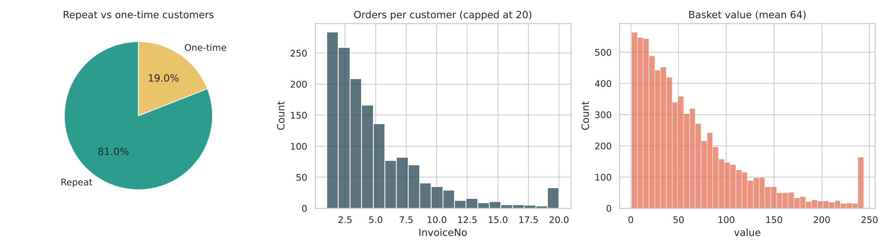
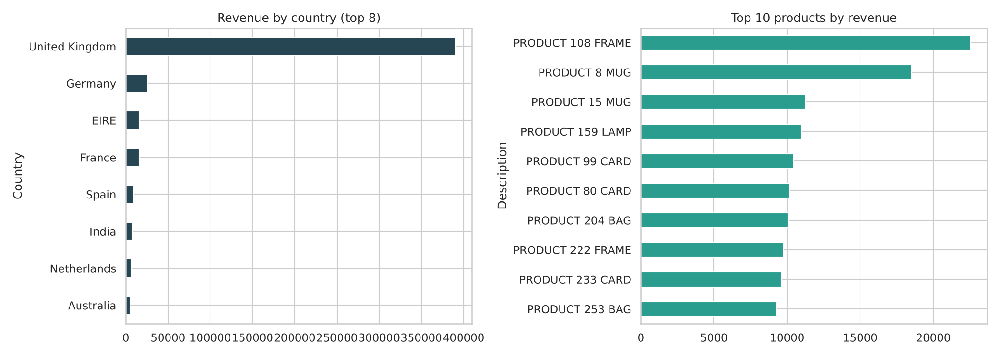
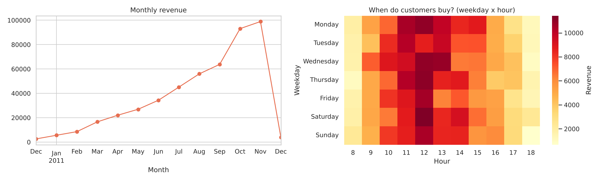
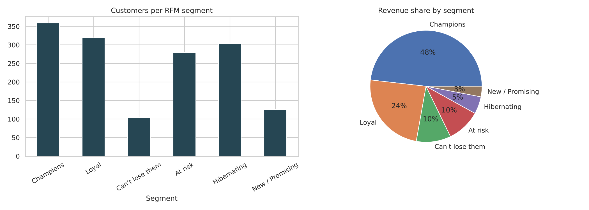

# E-commerce Customer Behaviour & RFM Analysis

**Level:** Advanced  
> Who are the best customers and when do they buy? Repeat behaviour, baskets, seasonality and RFM segmentation.

> **Before you publish:** this repo ships with a *synthetic sample dataset* in the same format as the real one so everything runs out of the box. Download the real dataset (see below), put it at `data/online_retail.csv`, re-run, and replace the Key Insights section with your real numbers. Then delete this note.

## Business questions

- How many customers are repeat customers?
- What is the average basket size?
- Which countries bring the most revenue?
- Which products sell best?
- What are the seasonal trends?
- Which customers are Champions, At risk or Lost? (RFM)

## Dataset

- Online Retail Dataset (UCI / Kaggle) - `online_retail.csv` (columns InvoiceNo, StockCode, Description, Quantity, InvoiceDate, UnitPrice, CustomerID, Country)
- Expected location: `data/online_retail.csv` (search the dataset name on Kaggle to download it)
- If the file is missing, `generate_data.py` creates a sample with the same columns automatically.

## Skills demonstrated

Data cleaning (cancellations, guest checkouts), Pandas, RFM scoring with `qcut`, segmentation, heatmaps

## Project structure

```
README.md
analysis.ipynb         notebook (cells run top to bottom)
analysis.py            same analysis as a script
cleaned_dataset.csv
images/               charts used in this README
data/                 raw data goes here
generate_data.py      sample-data generator
requirements.txt
powerbi/              dashboard guide + export for Power BI
```

## How to run

```bash
pip install -r requirements.txt
python analysis.py             # or: jupyter notebook analysis.ipynb
```

`rfm_segments.csv` (one row per customer with R, F, M scores and segment) is ready to import into Power BI/Excel.

## Key insights

_Run the analysis and paste the five printed insights here, each with a recommendation. Example format:_

1. **Finding with a number** - e.g. "Month-to-month contracts churn at 3x the rate of two-year contracts."
   - *Recommendation:* what the business should do about it.
2. ...

## Visualizations






## Interview talking points

- How I scored R/F/M from 1-5 and why frequency uses `rank(method='first')` (ties break `qcut`).
- What marketing action I would take for each segment.

## Resume bullet (fill in your numbers)

> Segmented [N]+ customers with RFM analysis; found 'Champions' were [x]% of customers but [y]% of revenue.

## Tech stack

Python, Pandas, NumPy, Matplotlib, Seaborn, Jupyter
